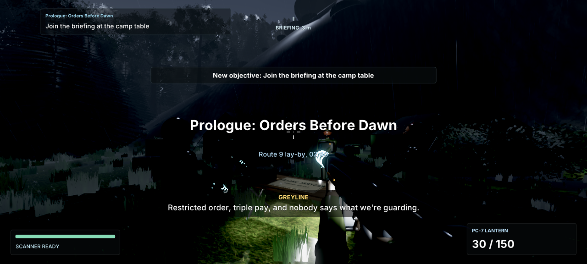

# SPECIAL OPS — Operation Iron Veil

A landscape, mobile-first, first-person cinematic squad shooter built on the
[VICTUS engine](https://github.com/FAHTHIZ/VICTUS). One storm night, a five-operator team, a
decommissioned relay station in the Kestrel Valley, and a conspiracy that ends with a very still
demonstration dummy standing behind a chair.

This repository is the game project only. VICTUS is the engine and is never copied in here.
The first physical target is the Infinix Hot 10S (6 GB). Desktop is the development platform.



## The story

Three nights ago, three posts on the Northline border corridor were hit. Every public statement
says Lydria did it. At 07:00 Karsovia's security council votes on emergency border powers.
Major Elias Venn, a military intelligence auditor, went missing near Kestrel Station after
reporting that the Northline record is false and that he had found the originals.

Halyard Team goes in under a storm front that grounds the station's drones and blinds its thermal
masts. The window closes at dawn; at 06:00 a Greyline convoy moves the originals somewhere nobody
can reach them. The full canon is in the [campaign story bible](docs/CAMPAIGN_STORY_BIBLE.md).

| Time  | Chapter | Where |
|-------|---------|-------|
| 02:40 | Prologue — Orders Before Dawn | Lay-by off Route 9, the Mule, Ranger Hollis |
| 03:05 | Op01 — Green Silence | Kestrel woods, fog in the hollows |
| 03:40 | Op02 — Dead Ground | Perimeter fence, sweeping searchlights |
| 04:05 | Op03 — Hard Entry | Flooded station yard |
| 04:20 | Op04 — The Paper War | Station interior, records office, breakers |
| 04:45 | Op05 — Below the Line | Bunker; Venn is found, Brick stays with him |
| 05:10 | Op06 — The Source Vault | Lower basement archive |
| 05:30 | Op07 — V-01 | The review chamber |
| 05:52 | Epilogue — First Light | The storm breaks over the valley |

## The squad

| Callsign | Role | Carries |
|----------|------|---------|
| Rook | the player, newest member | PC-7 Lantern, SP-2 Wren, field scanner (FK-1 kit once found) |
| Anchor | team lead | PC-7 Lantern |
| Patch | medic | KV-5 Hornet |
| Echo | scout | MR-6 Kestrel |
| Tally | communications | PC-7 Lantern |
| Brick | breacher | BR-9 Ram |

Lamplight is the headquarters handler on the radio, Hollis the local ranger who drives the flooded
forestry track, Captain Dorian Sorn the Greyline field commander. All dialogue is voiced (offline
Kokoro TTS) with subtitles and lip motion, plus idle squad chatter between story beats.

## Weapons

All weapons are fictional non-lethal pulse emitters with a realistic hardware look (rails, optics,
polymer and machined metal, wet sheen). Rook starts with the Lantern and Wren; the rest are in the
camp arms case and in station storage lockers.

| Weapon | Type |
|--------|------|
| PC-7 Lantern | pulse carbine |
| SP-2 Wren | pulse sidearm |
| KV-5 Hornet | compact high-rate PDW |
| BR-9 Ram | pump-action close-range spread gun (8 pellets) |
| MR-6 Kestrel | semi-auto marksman emitter, 4x optic |
| LR-4 Heron | scoped long emitter |

Every primary has a weapon light (LIGHT button) that matters in fog and in the basement.

## The night

Built to show what VICTUS renders on a phone: overcast storm night with a weak moon, rain with
splashes and ripples, wet ground and puddles, volumetric ground fog lit by lamps, sodium
floodlights and sweeping searchlights, lightning that actually lights the scene with thunder delayed
by distance, interiors that hear the storm through the structure, and a dawn epilogue.

## Controls

| Action | Keyboard / mouse | Gamepad | Touch |
|--------|------------------|---------|-------|
| Move / look | WASD / mouse | left / right stick | floating stick (left), drag (right) |
| Fire / aim | LMB / RMB | RT / LT | FIRE / AIM |
| Reload / switch | R / Q (1, 2 direct) | X / Y | RELOAD / SWITCH |
| Use | E or F | B | USE |
| Scanner / kit | T / G | D-pad up / left | TOOL / KIT |
| Weapon light | L | D-pad right | LIGHT |
| Jump / sprint / crouch | Space / Shift / C | A / L3 / R3 | JUMP / CROUCH |
| Objectives / pause | Tab / Esc | Back / Start | OBJ / II |
| Quick save / load | F5 / F9 | | |

## Building and running

Build VICTUS first (see its README), then put `victus` on `PATH`:

```sh
export PATH=/path/to/VICTUS/build/rel/bin:$PATH
victus import game          # cook assets
victus check game           # validate scenes and scripts
victus run game             # play on desktop
victus export game --out out/special_ops --name special_ops
```

Android uses the engine's Gradle shell ([VICTUS docs/ANDROID.md](https://github.com/FAHTHIZ/VICTUS/blob/main/docs/ANDROID.md)):

```sh
gradle -p platforms/android assembleDebug -Pvictus.game=$PWD/out/special_ops \
    -Pvictus.applicationId=io.github.fahthiz.specialops -Pvictus.appName="Special Ops"
```

Most content is generated from source scripts in `tools/` (world, facility, chapters, weapons,
SFX, music, voices); see [asset provenance](docs/ASSET_PROVENANCE.md). Automated play tests:

```sh
SOPS_TEST_FRAMES=8000 python3 tools/test/run_autotests.py story_prologue weapons armory
```

## Status

Honest state, see the [build and test log](docs/BUILD_AND_TEST_LOG.md) for evidence:

- The full campaign, prologue to credits, is implemented, and the story test plans pass as
  automated play-throughs on desktop Linux (virtual display, software rendering).
- The desktop export builds and boots to the menu.
- Not yet validated on a phone. No performance number for the Hot 10S exists until it is measured
  on the device.
- Known issue: an intermittent script time-budget warning from the face animation helper during
  Op01 on slow machines.

## Documentation

- [AGENTS.md](AGENTS.md) — rules for anyone (human or agent) working in this repository
- [Project brief](docs/PROJECT_BRIEF.md)
- [Campaign story bible](docs/CAMPAIGN_STORY_BIBLE.md)
- [Campaign and cinematics](docs/CAMPAIGN_AND_CINEMATICS.md)
- [Squad banter and ambience](docs/SQUAD_BANTER_AND_AMBIENCE.md)
- [Operators and weapon design](docs/OPERATORS_AND_WEAPON_DESIGN.md)
- [Characters, animation and audio](docs/CHARACTERS_ANIMATION_AUDIO.md)
- [Stage 01: Forest](docs/STAGE_01_FOREST.md)
- [Mobile target and controls](docs/MOBILE_TARGET_AND_CONTROLS.md)
- [VICTUS engine audit](docs/VICTUS_ENGINE_AUDIT.md)
- [Production plan](docs/PRODUCTION_PLAN.md)
- [Research register](docs/RESEARCH_REGISTER.md)
- [Asset provenance](docs/ASSET_PROVENANCE.md)
- [Build and test log](docs/BUILD_AND_TEST_LOG.md)
