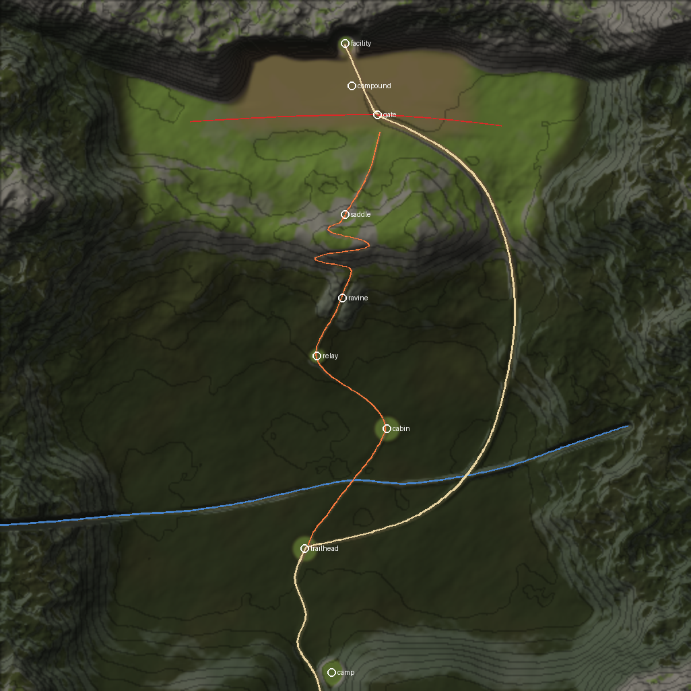

# Kestrel Valley — continuous campaign world

Status legend: **implemented** (code/data exists), **built** (imports and checks clean),
**simulated** (autotest on lavapipe), **visually inspected** (screenshot reviewed),
**device-tested** (Infinix Hot 10S). Nothing in this document is device-tested yet.

## Intent

Operations 01–03 happen in **one continuous 1024 × 1024 m landscape**, not in separate
arenas. The player walks from the dense valley forest up a hillside, crosses a ridge saddle,
looks down on the perimeter, and goes on to the compound and the facility portal cut into the
northern mountain. The squad vehicle uses the ranger/service road around the east side between
operations. Interiors (Op04–07) are separate scenes entered through the portal.

Single source of truth: `tools/world/worldmap.py`. `python3 tools/world/worldgen.py all`
regenerates the heightfield, splat, vegetation, canopy proxies, the persistent scene, the
streaming cells and the viewpoint test scenes.

## Regions (south → north)

| Region | z range | Character | Cover |
|---|---|---|---|
| South gap / ranger road | 540 → 300 | road enters through a notch in the southern hills | 0.95 |
| Op01 valley forest | 300 → 0 | dense mixed broadleaf/conifer, creek, cabin clearing, relay knoll | 1.0 |
| Ravine | −30 → −106 | rock-walled cut on the trail; ambush | 0.75 |
| Hillside | −110 → −190 | thinning trees, meadow, outcrops, switchbacks | 0.38 → 0.05 |
| Ridge saddle | ≈ −194 | overlook, first view of the perimeter | 0.05 |
| Op02 perimeter | −230 → −345 | north slope, cleared fence strip, towers, gate | 0.28 → 0 |
| Op03 compound / portal | −346 → −448 | plateau at 70.5 m, facility in the mountain face | 0 |

Conifer share rises with altitude so the forest visibly changes as the player climbs.

## Lynch elements (Image of the City applied to wayfinding)

- **Paths:** the footpath (1.8 m, graded) and the ranger/service road (5 m). Trail markers every
  34 m; a sign at the trailhead.
- **Edges:** the creek (crossed only at the footbridge), ravine walls, the forest edge on the
  hillside, the perimeter fence and its 14 m cleared strip, and the mountains outside the play area.
- **Districts:** valley forest, hillside meadow, perimeter, compound.
- **Nodes:** trailhead turnout, footbridge, cabin clearing, relay knoll, saddle, gate.
- **Landmarks:** global landmarks are the relay mast (visible from the forest canopy gaps and the
  hillside) and the northern mountain with the facility (visible from the saddle onward). Local
  landmarks are the footbridge, the cabin and the ravine mouth.

## Route storyboard (Op01 → Op03)

1. Arrival: the Mule comes up the ranger road and stops at the turnout (cinematic, external camera),
   then cuts to first person as the player exits. Trunk loadout.
2. Trail into the forest: close canopy, under-canopy light, ferns, a sign.
3. Creek and footbridge: the first opening, with water audio and a view up and down the creek.
4. Cabin clearing: Ranger Hollis, a dialogue scene (listeners face the speaker).
5. Relay knoll: climb out above the canopy for the first look at the ridge (the weenie for the next leg).
6. Ravine: walls close in; ambush from the rim; the squad uses rocks for cover.
7. Hillside: the forest thins, switchbacks, the sky opens and the light changes.
8. Saddle overlook: a staged view down onto the perimeter, fence and towers, with the facility in the
   mountain behind (the triangle rule: the ridge hides the perimeter until this reveal).
9. Op02/Op03 continue downhill to the fence, the gate and the compound.

## Trail grades

Target per USDA FS trail guidance (see RESEARCH_REGISTER §10): average 5–10%, sustained <7–10%,
short pitches up to ~25–40% for hiker class trails. The generator grades the trail with a Lipschitz
envelope (max grade 0.18) and an earthworks `max_cut` clip of 2 m, so it never creates
embankments. Measured: most legs meet the target, but the ravine/hillside still has p90 ≈ 0.35 and
max ≈ 0.66 over short spans, which is under the controller's 48° slope limit but steeper than the
guidance. **Open issue:** add more switchbacks or steps at the steepest spans.

## Vegetation and streaming

- Trees on a jittered 3.4 m grid, probability = cover^1.15 × 0.62, giving ≈540 trees/ha at full
  cover (inside the published 450–1383/ha for mixed broadleaf stands). ≈27k trees in total,
  ≈18.9k detailed inside the play area. Capsule trunk colliders, tag `Tree`.
- Ground cover is engine foliage (GPU-instanced, per-chunk culled) under the Terrain: ferns,
  two grass layers, a verge along paths, and shrubs.
- `victus world` splits the scene into 187 streaming cells (64 m). The player is the
  StreamingSource (load radius 96 m).
- Canopy proxies: merged low-poly crown blocks, 64 m near blocks aligned to the streaming cells and
  128 m far blocks. `scripts/world/canopy.luau` hides a near block while its cell's real trees
  are loaded, so the player never sees proxies up close and the horizon never looks empty.

## Evidence

Screenshots in `docs/evidence/world_*.png` (see BUILD_AND_TEST_LOG for commands and SHAs).
Rendered on lavapipe (CPU Vulkan) at 1280 × 576, medium quality. Frame times on lavapipe are
1–2.4 s per frame for the world, so they say nothing about phone performance. **Infinix Hot 10S
performance is untested.**
